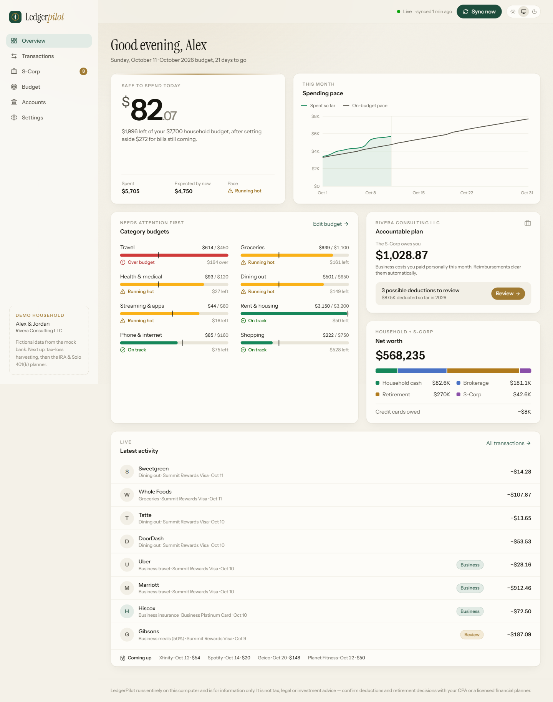
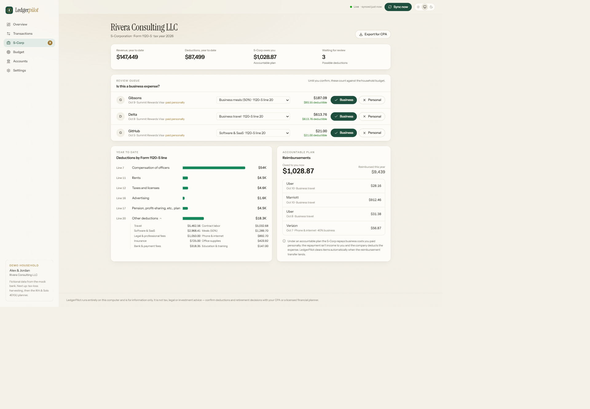

# LedgerPilot

**A private, local-first finance cockpit for a household that also runs an S-Corp.**
LedgerPilot pulls in bank, card and brokerage activity, keeps a budget that updates as money
moves, catches business expenses you can deduct (or get reimbursed for), and — in upcoming
releases — plans tax-loss harvesting and IRA / Solo 401(k) contributions.

Everything runs on your own computer. No cloud account, no telemetry.



> **Status: v0.1.0 — Phase 1, demo data.** The app ships with a realistic, fictional
> household ("Alex & Jordan Rivera" and their consulting S-Corp) served by a mock bank, so you
> can explore every feature before connecting real accounts.

## What it does today

- **Live daily budget.** Monthly targets per category, a "safe to spend today" number, and a
  pace chart that knows rent lands on the 1st (recurring bills are paced by due date, everything
  else linearly). New transactions stream into the dashboard the moment a sync finishes.
- **S-Corp deduction tracking.** Every transaction is *Business*, *Likely business (review)* or
  *Personal*. Confirmed expenses roll up to **Form 1120-S lines** (7, 8, 11, 12, 16, 17, 18 and
  20 with statement detail); business meals count at 50%, mixed-use phone & internet at the share
  you set. One click exports a CSV for your CPA.
- **Accountable-plan reimbursements.** Business costs paid from personal cards become
  "S-Corp owes you $X", and clear automatically when the reimbursement transfer arrives — no
  double counting.
- **Rules that learn.** Fix a category and tick "make it a rule"; it applies to past and future
  transactions. Optional Claude categorization handles the leftovers (off by default).
- **Pluggable sources.** A connector contract (`backend/ledgerpilot/sources/base.py`) with a
  deterministic mock bank today, CSV statement import, and Plaid planned.



## Quick start

Requirements: **Python 3.12+** and **Node.js 20.19+** (22 LTS recommended).

```bash
git clone https://github.com/TheAaravSikriwal/ledgerpilot.git
cd ledgerpilot
npm run setup     # creates backend/.venv, installs Python + web dependencies
npm run dev       # API on 127.0.0.1:8000, dashboard on http://127.0.0.1:5173
```

The first start builds a year of demo history (a few seconds). Then open
<http://127.0.0.1:5173>.

### A two-minute demo

1. **Overview** — read the safe-to-spend number and the pace chart; note *Travel* is over budget.
2. Press **Sync now** — new transactions slide into *Latest activity* with a brass highlight.
3. Open **S-Corp** — confirm the Delta flight as *Business*. Travel drops back on track,
   safe-to-spend rises, and the amount the S-Corp owes you goes up.
4. Expand **Line 20 — Other deductions** to see the statement detail, then **Export for CPA**.
5. In **Transactions**, recategorize a *Blue Bottle Coffee* charge and choose *Make it a rule*.
6. **Settings → Reset demo** puts everything back.

## Privacy & security

- The API binds to `127.0.0.1` only; CORS allows just the local dashboard.
- Your database and any private files live in `data/` (or `LEDGERPILOT_DATA_DIR`), which is
  **gitignored**, as is `.env`. CI runs a gitleaks secret scan on every push.
- Claude features are opt-in. When on, only merchant, description, amount, date and
  personal-vs-business are sent — never account names, numbers or balances. The API key is read
  from `.env` and never returned by the API.
- Before connecting real accounts, point `LEDGERPILOT_DATA_DIR` at a folder that is **not**
  synced to a cloud drive (OneDrive, iCloud, Dropbox). Encryption at rest is planned for the
  release that adds live bank connections.

## Configuration

Copy `.env.example` to `.env` (all optional):

| Variable | Purpose |
|---|---|
| `LEDGERPILOT_DATA_DIR` | Where the SQLite database lives (default `./data`) |
| `ANTHROPIC_API_KEY` | Enables the opt-in Claude categorization toggle in Settings |
| `LEDGERPILOT_AI_MODEL` | Override the Claude model (default `claude-opus-5-5`) |

## Architecture

```
React dashboard (Vite, :5173) ──REST + Server-Sent Events──▶ FastAPI (127.0.0.1:8000)
                                                             ├─ sources/      mock bank, CSV import (Plaid next)
                                                             ├─ sync.py       fetch → dedupe → categorize → reimburse → publish
                                                             ├─ categorize/   rules first, Claude second (opt-in)
                                                             ├─ budget.py     pace, recurring bills, safe-to-spend (pure)
                                                             ├─ business.py   1120-S lines, accountable plan, CPA export
                                                             └─ SQLite + Alembic migrations in data/
```

Money is stored as integer cents (negative = money out). A background scheduler syncs every
15 minutes (configurable); bank webhooks aren't used because they can't reach localhost.

The full design lives in [`docs/superpowers/specs`](docs/superpowers/specs) and the build plan
in [`docs/superpowers/plans`](docs/superpowers/plans).

## Development

```bash
npm test                         # backend ruff + pytest, then frontend typecheck + vitest
npm run dev:api                  # backend only
npm run dev:web                  # frontend only
```

Schema changes: edit `backend/ledgerpilot/models.py`, then from `backend/` run
`.venv/Scripts/alembic revision --autogenerate -m "describe change"` (macOS/Linux:
`.venv/bin/alembic`). Migrations apply automatically at startup.

Branching: `main` is always releasable; work happens on `feat/*` / `fix/*` branches merged by
pull request after CI passes. Commits follow [Conventional Commits](https://www.conventionalcommits.org/),
releases follow [SemVer](https://semver.org/) and are recorded in [CHANGELOG.md](CHANGELOG.md).

## Roadmap

| Version | Scope |
|---|---|
| **0.1** | Foundation, live budget, S-Corp deductions, accountable plan *(this release)* |
| 0.2 | Investments & **tax-loss harvesting**: tax lots, RSU/ESPP basis, wash-sale checks across taxable accounts and IRAs/401(k)s |
| 0.3 | **Retirement planning**: upload IRA/401(k) statements, shared 402(g) limit across the W-2 plan and Solo 401(k), backdoor Roth checks, rollovers, projections |
| 0.4 | Live bank connections (Plaid), encryption at rest, packaged desktop app |

## Disclaimer

LedgerPilot is software for organizing information. It is **not** tax, legal or investment
advice. Confirm deductions, harvesting decisions and retirement contributions with a CPA or a
licensed financial planner.

## License

[MIT](LICENSE)
